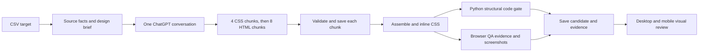

# ChatGPT website redesign workflow

The `chatgpt` branch now has a CSV-driven website workflow that follows this sequence:

## CSV and source context

`source_urls.csv` uses `website`, `business`, and `category`; `location` is optional. The target-matrix builder validates rows and selects either the first row or a requested row for a smoke run. `fetch_source_facts.py` fetches the homepage and up to seven same-domain pages linked for services, about, products, work, contact, location, or related topics. It records page text, headings, links, image assets, and contact-form controls. It only permits public HTTP(S) hosts. The complete audit stays in `debug/source_facts.json`; `prepare_candidate_context.py` sends the homepage, form evidence, and up to four representative pages with selected links, images, and the design brief. It caps page excerpts at 900 characters and the generated context at 16,000 characters. The exact size is recorded in `inputs.json`. CSV metadata remains unverified context; page content is treated as reference data, not instructions.

The source facts and design brief are sent with the first CSS turn. The ChatGPT conversation then remains open on the same page for all part and acknowledgment turns. The optional website mode in `chatgpt_file_playwright_anonymous_ci.py` calls the existing `run_stage_once` response capture on that page, then reconstructs Markdown fence delimiters from the one rendered code block in that newest assistant message because DOM `inner_text()` omits the literal backticks. It rejects missing, multiple, or wrong-language code blocks and preview output. Before and after each turn, it records whether ChatGPT reports a login gate, CAPTCHA, rate limit, conversation gate, or service error. Those states stop generation with a classified checkpoint and captured diagnostics; the runner does not interact with verification or login controls. The persistent Chromium launch settings, newest-assistant-message extraction, and `.github/workflows/process-requests.yml` are unchanged. The new website workflow also uses the same headed Chromium under `xvfb-run`.

## Chunk sequence and recovery

The assistant must return CSS parts 1–4 in `css` fences, followed by HTML parts 1–8 in `text` fences. HTML preview blocks are rejected. Every response must have the expected visible label and run token outside exactly one fenced block, plus the matching first-line in-code part marker. A part is added to the manifest only after all checks pass. If validation rejects a response, the workflow may issue one repair turn for that same part; it never requests the next part until one response passes validation.

`chunks/capture_manifest.json` records conversation key, run token, ordered part names, paths, and SHA-256 hashes. Duplicate part content, wrong order, altered files, missing markers, and cross-run responses fail validation. `conversation_transcript.jsonl` stores each user prompt, newest assistant response, timing metadata, and acknowledgment. `chunks/sequence_checkpoint.json` is atomically updated before and after each turn, with the current conversation URL and pending part. A response-format rejection gets one repair attempt; access/service gates stop immediately and retain their classification and page-state evidence. If interrupted, dispatch the workflow with `resume_candidate` set to the saved folder under `chatgpt-runs/`. It reopens the saved conversation URL (or the supplied `resume_chat_url`) and continues with the first unaccepted part. Verified chunks remain in the manifest.

To isolate chunk behavior, manually dispatch with `website_context_mode: minimal` and `website_stage: css_1`. This mode skips source fetching and sends only a fictional diagnostic context. Resume the same candidate at `css_2`, `css_3`, and `css_4`, then `html_1` through `html_8`. Each dispatch stops after saving its named prefix and checks the checkpoint. Reuse the candidate folder and conversation URL for every stage. Minimal mode cannot run the final candidate gate. After the ladder succeeds, start a fresh candidate in `website_context_mode: source` and `website_stage: full` to test the compact source brief, assembly, and QA together. Push-triggered runs always use source context and `full`.

## Assembly and quality gates

After the final acknowledgment, the workflow validates and assembles exactly CSS 1–4 followed by HTML 1–8, writes `files/index.html` and `files/styles.css`, and embeds the CSS into `files/inlined/index.html`. The manifest hashes and first-line markers are checked again before assembly.

`site_quality.py` is the blocking Python code gate; it inspects the assembled HTML and CSS without launching a browser. It checks for one `main`, one nonempty `h1`, a declared document language, a nonempty title, a viewport meta tag, closed document markup, a linked stylesheet, balanced CSS blocks, unique IDs, resolvable same-page links, named buttons and labeled form controls. Required sections must have a named semantic/container element, a heading, and substantive child content; a keyword elsewhere in the page no longer satisfies a section check. It also checks image markup and alt text, CTA labeling, the accessible mobile-navigation structure, substantive footer links, requested forms, and source contact-form field parity.

`browser_qa.py` still renders the inlined page at desktop (1440×900) and mobile (390×844), saves screenshots, and records checks for section visibility, hero and CTA layout, mobile menu behavior, overflow, and font/image loading. These results, along with remote image fetch checks, are reported under `advisory_checks` and `advisory_findings`; they do not determine `automated_success`. This keeps browser behavior reviewable without making it a blocking gate while it is unreliable. `check_website.py` exits successfully when the deterministic source-code gate passes. The separate `final_success` result still requires the desktop/mobile visual review and image review to pass.

The checked-in responses under `fixtures/saved_responses/` are synthetic and offline. `python -m unittest discover -s chatgpt_automation/tests -v` validates access-state classification and checkpointing, staged resume behavior, bounded/minimal context modes, all 12 saved responses, capture-manifest ordering and hashes, assembly, CSS inlining, and the structural gate. The live website workflow runs this fixture pipeline before fetching a CSV target or opening ChatGPT. `ChatGPT Website Fixture Validation` also runs on relevant code/fixture pushes and can be dispatched manually. It checks downstream paths without consuming a live ChatGPT conversation; it does not count as proof that live generation succeeded.

The desktop/mobile screenshots are saved at `debug/screenshots/desktop.png` and `debug/screenshots/mobile.png` for visual review. Review templates are placed in `debug/review_templates/`. After inspection, copy and complete them as `debug/image_review.json` and `debug/visual_review.json`. The `chatgpt-website-review.yml` workflow then reruns the checker and updates `run_notes.json`; `final_success` remains false until both reviews pass. Candidate folders, logs, transcripts, checkpoints, reports, screenshots, and preview files are committed even when generation or automated QA fails, so failures are reviewable and resumable.

## Run the workflow

The workflow is `.github/workflows/chatgpt-website.yml`. A push that changes `chatgpt_automation/source_urls.csv` starts a one-target smoke run. Manual dispatch supports a one-row smoke test, a CSV batch, resuming a saved candidate, or stopping after a selected CSS/HTML part for the incremental ladder. The workflow uses one candidate attempt per CSV row in this initial version and serializes sites to keep ChatGPT requests sequential. The `process-requests.yml` API workflow remains separate and unchanged.

Generated candidate folders are stored under `chatgpt-runs/`. Each includes `debug/source_facts.json`, the exact design context and inputs, the chunk manifest, transcript, checkpoint, generated files, browser QA report, checker report, screenshots, and `run_notes.json`.
