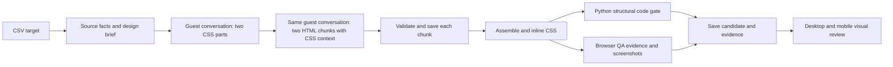

# ChatGPT website redesign workflow

The `chatgpt` branch now has a CSV-driven website workflow that follows this sequence:

## CSV and source context

The live target CSV is maintained privately on `git-content-private/main`; this public branch contains no target rows. The worker receives one target through a temporary, provider-specific Actions secret, masks its fields, and checks the private job record before generation. `fetch_source_facts.py` fetches the homepage and up to seven same-domain pages linked for services, about, products, work, contact, location, or related topics. It records page text, headings, links, image assets, and contact-form controls. It only permits public HTTP(S) hosts. The complete audit stays in `debug/source_facts.json`; `prepare_candidate_context.py` sends a compact brief with the homepage identity, a few verified facts and section headings, labeled contact fields, conversion links, validated same-site images, and the design brief. Source and fallback image URLs are checked for image bytes before being included; category-matched fallbacks fill gaps when valid source photos are insufficient. Raw page excerpts, duplicated navigation, and unverified CSV hints are excluded from the prompt. The generated context is capped at 4,300 characters and its exact size is recorded in `inputs.json`. Page content remains reference data, not instructions. A failed candidate's recognized quality-check names become short correction guidance for the next candidate.

The source facts and design brief are sent with the first CSS turn. Both CSS parts and both HTML parts stay in one guest conversation. The first HTML prompt includes the accepted CSS as reference context. The optional website mode in `chatgpt_file_playwright_anonymous_ci.py` calls the existing `run_stage_once` response capture on that page, then reconstructs Markdown fence delimiters from the one rendered code block in that newest assistant message because DOM `inner_text()` omits the literal backticks. It rejects missing, multiple, or wrong-language code blocks and preview output. Before and after each turn, it records whether ChatGPT reports a login gate, CAPTCHA, rate limit, conversation gate, or service error. Those states stop generation with a classified checkpoint and captured diagnostics; the runner does not interact with verification or login controls. The persistent Chromium launch settings, newest-assistant-message extraction, and `.github/workflows/process-requests.yml` are unchanged. The new website workflow also uses the same headed Chromium under `xvfb-run`.

## Chunk sequence and recovery

The assistant returns two ordered stylesheet parts as `css` fences: part 1 defines the foundation, hero, and primary content; part 2 styles contact, footer, responsive behavior, focus, and reduced motion. It then returns two ordered HTML fragments in `text` fences: part 1 opens the document and builds the hero and primary content; part 2 adds remaining content and contact, closes the main document, adds the footer, and closes the document. The first HTML prompt includes the accepted CSS as style/class reference while staying in the same guest conversation. The user prompt explicitly requests literal source text in a `text` fence, not an HTML preview or artifact. No acknowledgment turn follows validated HTML; the pipeline proceeds directly to local assembly and QA. The source-mode prompt asks for reusable rules tied to the sections actually used and a concise semantic document, while retaining source-grounded content and existing contact fields. HTML preview blocks are rejected. Each response must have the expected `CSS PART n OF 2` or `HTML PART n OF 2` label and run token outside exactly one fenced block, plus the matching first-line in-code marker. A part is added to the manifest only after all checks pass. If the page remains available but a response is empty, the workflow resends that part once. A captured response that fails validation gets one separate repair turn. Access, login, rate-limit, and service gates still stop immediately; the next part is requested only after validation passes.

`chunks/capture_manifest.json` records conversation key, run token, ordered part names, paths, and SHA-256 hashes. Duplicate part content, wrong order, altered files, missing markers, and cross-run responses fail validation. `conversation_transcript.jsonl` stores each user prompt, newest assistant response, and timing metadata. `chunks/sequence_checkpoint.json` is atomically updated before and after each turn, with the current conversation URL and pending part. Empty-response resends and response-format repairs have separate one-attempt limits; access/service gates stop immediately and retain their classification and page-state evidence. Checkpoints record the chunk/conversation plan so candidates created under an older plan cannot be resumed accidentally. Verified chunks remain in the private candidate manifest. The private worker currently starts a fresh candidate conversation for every attempt; legacy staged-resume controls are no longer exposed on the public workflow.

Production jobs use source context and a full run. The private coordinator submits one target at a time, and the public worker generates complete candidates until three pass or ten attempts are reached. If all ten attempts finish with fewer than three passes and no login, CAPTCHA, rate-limit, conversation-gate, or service-error classification was observed, the coordinator queues one continuation with up to ten additional candidates. Passing candidates and attempt counts carry forward, for a maximum of twenty total attempts. The continuation does not run for access/service gates, missing run evidence, or source-facts failures. Staged diagnostic and resume behavior remains in the pipeline code but is not dispatched through the private production queue.

## Assembly and quality gates

After all four validated responses, the workflow assembles the two CSS and two HTML chunks, writes `files/index.html` and `files/styles.css`, and embeds the CSS into `files/inlined/index.html`. The manifest hashes, order, and first-line markers are checked again before assembly.

`site_quality.py` is the blocking Python code gate; it inspects the assembled HTML and CSS without launching a browser. It checks for one `main`, one nonempty `h1`, a declared document language, a nonempty title, a viewport meta tag, closed document markup, a linked stylesheet, balanced CSS blocks, unique IDs, resolvable same-page links, named buttons and labeled form controls. Required sections must have a named semantic/container element, a heading, and substantive child content; a keyword elsewhere in the page no longer satisfies a section check. It also checks image markup and alt text, CTA labeling, the accessible mobile-navigation structure, substantive footer links, requested forms, and source contact-form field parity.

`browser_qa.py` renders the inlined page at desktop (1440×900) and mobile (390×844), saves screenshots, and checks section visibility, hero geometry and image coverage, first-screen CTAs, mobile menu visibility and keyboard behavior, overflow, and font/image loading. Hero media must cover the entire hero at both viewport sizes; a split-column image fails the automated gate. The hero image and visible content images must load, and three distinct image paths must pass the Python image-byte check. CTA arrow validation runs on the final inlined file and checks rendered labels, icons, and CSS pseudo-elements at both viewports. Font loading and failures in hidden, non-content images remain advisory. The separate `final_success` result still requires the desktop/mobile visual review and image review to pass.

The checked-in responses under `fixtures/saved_responses/` are synthetic and offline. `python -m unittest discover -s chatgpt_automation/tests -v` validates access-state classification and checkpointing, staged resume behavior, bounded/minimal context modes, both saved full-response fixtures, capture-manifest ordering and hashes, assembly, CSS inlining, the structural gate, and continuation eligibility, evidence handling, candidate counting, and inheritance. The live website workflow runs this fixture pipeline before fetching a CSV target or opening ChatGPT. `ChatGPT Website Fixture Validation` also runs on relevant code/fixture pushes and can be dispatched manually. It checks downstream paths without consuming a live ChatGPT conversation; it does not count as proof that live generation succeeded.

The desktop/mobile screenshots are saved at `debug/screenshots/desktop.png` and `debug/screenshots/mobile.png` for visual review. Review templates are placed in `debug/review_templates/`. After inspection, copy and complete them as `debug/image_review.json` and `debug/visual_review.json` in the private results branch. The private repository's `.github/workflows/chatgpt-review.yml` workflow reruns the checker and updates `run_notes.json`; `final_success` remains false until both reviews pass. Candidate folders, logs, transcripts, checkpoints, reports, and screenshots are saved privately even when generation or automated QA fails, so failures remain reviewable. The production queue starts a fresh candidate conversation on a later attempt rather than resuming a failed conversation.

## Run the workflow

The workflow is `.github/workflows/chatgpt-website.yml`. It runs only when the private coordinator pushes an opaque marker to the public `chatgpt` branch. The public job validates the marker and private job record, then runs source collection and generation in the anonymous ChatGPT browser session. The Xvfb launch configuration and ChatGPT Playwright arguments are kept as before. The workflow does not run on code pushes or expose manual URL inputs. A job generates up to ten candidates. If it finishes with fewer than three automated passes and no access/service gate was recorded, the private coordinator queues one continuation for up to ten more candidates and carries forward the first run's passes. Access/service gates and source-facts failures are terminal. Evidence from each workflow run is saved privately; a successful continuation lists inherited and newly generated passing HTML together.

The public worker sends the active source row and derived page context to ChatGPT while the run is active. Candidate directories, source facts, prompts, transcripts, screenshots, browser logs, and reports are committed only to `git-content-private/chatgpt`, under `results/<site-slug>/run-<workflow-id>-<attempt>/candidates/`. The results index links each run to the public workflow status and to private candidate files. Human visual and image review records are stored with the private candidates.

The branch-tip target CSV is header-only. The Duck.ai history cleanup rewrote all public branch histories to remove legacy Duck.ai run files, Duck.ai source URL snapshots, and Duck.ai queue markers. It did not remove legacy `chatgpt-runs/` files from the public ChatGPT history, and it did not delete old Actions logs or GitHub-side copies. Those historical ChatGPT files remain public even though a private archive is also available in `git-content-private/chatgpt`.
