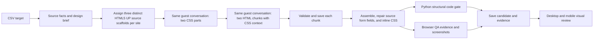

# ChatGPT website redesign workflow

## Repository ownership and handoffs

This workflow crosses three repositories. Each repository has a distinct owner role; the public repository coordinates work but does not own the private customer queue, slot ledger, or publish-ready HTML.

| Repository | Owns | Sends / receives |
| --- | --- | --- |
| [`git-content`](https://github.com/hometownredesignsites/git-content) (public, `chatgpt` branch) | Generation workflows and scripts, automated candidate validation, staging logic, and the hourly slot orchestrator. The orchestrator's public logs must remain free of customer identifiers and HTML. | Reads an opaque job marker and job data from `git-content-private`; writes successful validated drafts and immutable batch snapshots to the three `content-post` slot branches; reads slot assignments, worker returns, the private ledger, and promotion progress from `content-post`. It assigns work but does not revise HTML or publish it. |
| [`git-content-private`](https://github.com/hometownredesignsites/git-content-private) (private) | The source customer/job data and private generation results: candidate HTML, source evidence, screenshots, prompts, logs, and review records. | Supplies authorized job inputs to the public generation workflow and receives its private candidate evidence/results. It is not the slot assignment ledger and does not promote or publish slot revisions. |
| [`content-post`](https://github.com/hometownredesignsites/content-post) (private) | The three worker slots, their active task files and return folders, the authoritative `automation/slot-ledger.json`, durable revised HTML, automated promotion records on `main`, and Cloudflare publishing. | Receives generation-approved drafts from `git-content`; gives one task at a time to each external worker through its slot branch; receives the worker's revised HTML and metadata; automatically promotes and publishes only when all three candidates for the same batch are present. |

### End-to-end handoff

1. `git-content-private` provides the private job input. The public `git-content` Action generates candidate pages, runs its own automated validation, and stores candidate evidence/results back in `git-content-private`.
2. Once three candidates pass, `git-content` stages one draft per slot on `content-post` branches `chatgpt-slot1`, `chatgpt-slot2`, and `chatgpt-slot3`. Each branch keeps `sites/<site-slug>/draft/index.html` and an immutable copy under `sites/<site-slug>/queue/<batch-id>/`.
3. The hourly `git-content` orchestrator reads and updates the ledger in `content-post/main`. When a complete batch is available, it assigns one company to all three slots by writing `sites/<site-slug>/todo-today/index.html` and `assignment.json` on each slot branch. Three external workers, one per slot, read their own assignment and return `todo-today/revised/index.html` plus `todo-today/revised/metadata.json`. Workers do not choose a company, edit the ledger, promote candidates, or deploy.
4. The orchestrator validates the return metadata and HTML, archives accepted files under `sites/<site-slug>/revised/`, and reconciles promotion progress from `content-post/main`. Assignment and reconciliation run hourly at minute 17 UTC; at most one new batch is assigned per Eastern calendar day. Schedule the workers after the 12:17 UTC run (adjust if the Action schedule changes).
5. The private `content-post` Action runs when the ledger changes and once daily as a safety check. It calls `scripts/promote_slot_revision.py` for each slot in a complete same-batch set, regardless of the order in which the workers finished. It then dispatches the Cloudflare publisher after all three numbered candidates and the ready marker are on `content-post/main`.

### Source of truth by state

- **Job and customer input / generation evidence:** `git-content-private`.
- **Draft, active worker assignment, and returned revision:** the matching `content-post` slot branch.
- **Slot assignment and reconciliation state:** `content-post/main` at `automation/slot-ledger.json`, maintained by the public `git-content` orchestrator.
- **Promoted candidate and publish readiness:** `content-post/main`, recorded in the candidate files and `progress.json`; `ready-for-cloudflare.json` is created only for a complete same-batch set.

The public Action needs the `CONTENT_POST_DISPATCH_TOKEN` secret, scoped to the private `content-post` repository with Contents read/write permission. External workers need their own authorized Git write route to their assigned slot branch. These are separate credentials and roles.

The `chatgpt` branch now has a CSV-driven website workflow that follows this sequence:

## CSV and source context

The live target CSV is maintained privately on `git-content-private/main`; this public branch contains no target rows. The worker receives one target through a temporary, provider-specific Actions secret, masks its fields, and checks the private job record before generation. `fetch_source_facts.py` fetches the homepage and up to seven same-domain pages linked for services, about, products, work, contact, location, or related topics. It records page text, headings, links, image assets, and contact-form controls. When static capture has little text or no images, a bounded Playwright supplement reads the rendered homepage and same-site frames, including text, forms, `` assets, and computed CSS backgrounds; requests are restricted to public HTTP(S) hosts and top-level documents stay on the requested site. The complete audit stays in `debug/source_facts.json`; `prepare_candidate_context.py` sends a compact brief with the homepage identity, a few verified facts and section headings, labeled contact fields, conversion links, validated same-site images, and the design brief. Source and fallback image URLs are checked for image bytes before being included; category-matched fallbacks fill gaps when valid source photos are insufficient. Raw page excerpts, duplicated navigation, and unverified CSV hints are excluded from the prompt. The generated context is capped at 4,300 characters; its exact size and source coverage counts are recorded in `inputs.json`. The first candidate also emits a workflow warning when it has no verified facts, service sections, or validated source photos. Page content remains reference data, not instructions. A failed candidate's recognized quality-check names become short correction guidance for the next candidate.

Generation uses three maintained HTML5 UP templates with locally bundled source HTML, CSS, and CCA 3.0 license files: Forty, Landed, and Story. ChatGPT orders these references by business fit; any missing or unsupported selection falls back to all three. `template_scaffolds.py` extracts a compact excerpt of the selected template's real markup and CSS for the prompt, plus a short below-hero layout signature. Every concept shares the strong full-screen hero, source-grounded content, contact/accessibility requirements, navigation limit, and a slot-specific palette: charcoal/ivory/rust, forest/sage/brass, or navy/cool gray/copper. Each selected scaffold keeps its distinct post-hero rhythm: Forty's image-backed tile composition, Landed's alternating split spotlights, or Story's divided panels and gallery/items. The complete template plan is saved in `debug/design_references.json`; each candidate's selected slot and reference are saved in `debug/design_reference.json`. Candidate attempts are assigned to the least-tried slot without a passing candidate. `palette.py` normalizes common template color-variable aliases, applies the assigned CSS custom properties, and records token usage and text-contrast checks in `debug/palette.json`; `site_quality.py` blocks a candidate if the palette or contrast checks fail. These repairs change CSS variables only. After assembly, attribution comments are inserted in both HTML and CSS and checked against the selected template. `browser_qa.py` checks the rendered desktop layout against that template's measured structure; its blocking signature check ensures the passing set includes the distinct expected layout for each slot. Generation receives only the selected compact scaffold excerpt and palette note, not all three full templates; source facts and design context remain capped at 4,300 characters. Both CSS parts and both HTML parts stay in one guest conversation. The first HTML prompt includes the accepted CSS as reference context. The optional website mode in `chatgpt_file_playwright_anonymous_ci.py` calls the existing `run_stage_once` response capture on that page, then reconstructs Markdown fence delimiters from the one rendered code block in that newest assistant message because DOM `inner_text()` omits the literal backticks. It rejects missing, multiple, or wrong-language code blocks and preview output. Before and after each turn, it records whether ChatGPT reports a login gate, CAPTCHA, rate limit, conversation gate, or service error. Those states stop generation with a classified checkpoint and captured diagnostics; the runner does not interact with verification or login controls. The persistent Chromium launch settings, newest-assistant-message extraction, and `.github/workflows/process-requests.yml` are unchanged. The new website workflow also uses the same headed Chromium under `xvfb-run`.

## Chunk sequence and recovery

The assistant returns two ordered stylesheet parts as `css` fences: part 1 defines the foundation, hero, and primary content; part 2 styles contact, footer, responsive behavior, focus, and reduced motion. It then returns two ordered HTML fragments in `text` fences: part 1 opens the document and builds the hero and primary content; part 2 adds remaining content and contact, closes the main document, adds the footer, and closes the document. The first HTML prompt includes the accepted CSS as style/class reference while staying in the same guest conversation. The user prompt explicitly requests literal source text in a `text` fence, not an HTML preview or artifact. No acknowledgment turn follows validated HTML; the pipeline proceeds directly to local assembly and QA. The source-mode prompt asks for reusable rules tied to the sections actually used and a concise semantic document, while retaining source-grounded content and existing contact fields. HTML preview blocks are rejected. Each response must have the expected `CSS PART n OF 2` or `HTML PART n OF 2` label and run token outside exactly one fenced block, plus the matching first-line in-code marker. A part is added to the manifest only after all checks pass. If the page remains available but a response is empty, the workflow resends that part once. A captured response that fails validation gets one separate repair turn. Access, login, rate-limit, and service gates still stop immediately; the next part is requested only after validation passes.

`chunks/capture_manifest.json` records conversation key, run token, ordered part names, paths, and SHA-256 hashes. Duplicate part content, wrong order, altered files, missing markers, and cross-run responses fail validation. `conversation_transcript.jsonl` stores each user prompt, newest assistant response, and timing metadata. `chunks/sequence_checkpoint.json` is atomically updated before and after each turn, with the current conversation URL and pending part. Empty-response resends and response-format repairs have separate one-attempt limits; access/service gates stop immediately and retain their classification and page-state evidence. Checkpoints record the chunk/conversation plan so candidates created under an older plan cannot be resumed accidentally. Verified chunks remain in the private candidate manifest. The private worker currently starts a fresh candidate conversation for every attempt; legacy staged-resume controls are no longer exposed on the public workflow.

Production jobs use source context and a full run. The scheduled High-site poller runs up to twelve candidates, then, if fewer than three distinct template slots pass and no non-login access/service gate or source-access failure is recorded, continues for up to twelve more candidates in the same workflow run. Passing candidates and global attempt numbering carry forward, for a maximum of twenty-four total attempts. A login-required response does not block continuation, so a follow-up may spend attempts retrying while that gate remains. The separate private batch coordinator can also queue a continuation job across workflow runs; the policy, evidence scan, candidate counting, status writing, and inheritance live in `scripts/continuation.py`. The coordinator loads the parent job from the provider branch, falling back to private `main` for legacy jobs, then writes the continuation job to the private `chatgpt` branch. Other access/service gates, missing run evidence, and source-facts failures remain terminal. Staged diagnostic and resume behavior remains in the pipeline code but is not dispatched through the private production queue.

## Assembly and quality gates

After all four validated responses, the workflow assembles the two CSS and two HTML chunks, writes `files/index.html` and `files/styles.css`, applies the slot palette, repairs missing source contact-form controls and minor generated visual defects when safe, and embeds the CSS into `files/inlined/index.html`. A uniquely button-controlled `.mobile-nav` is hidden by default and shown only while open; navigation repair is recorded with the other visual repairs. Palette and repair reports are recorded under `debug/`. The normal structural checker and desktop/mobile browser QA then run against the repaired page; repairs do not bypass either gate. Unsupported controls or an unclear contact target remain failures for manual review. The manifest hashes, order, and first-line markers are checked again before assembly.

`site_quality.py` is the blocking Python code gate; it inspects the assembled HTML and CSS without launching a browser. It checks for one `main`, one nonempty `h1`, a declared document language, a nonempty title, a viewport meta tag, closed document markup, a linked stylesheet, balanced CSS blocks, unique IDs, resolvable same-page links, named buttons and labeled form controls. Required sections must have a named semantic/container element, a heading, and substantive child content; a keyword elsewhere in the page no longer satisfies a section check. It also checks image markup and alt text, CTA labeling, no more than five links in each header menu (including CTAs), the accessible mobile-navigation structure, substantive footer links, requested forms, and source contact-form field parity. Before browser QA, `repair_generated_visuals.py` adds scoped contrast treatments for alternate CTAs in light contact sections and labels over image-backed tiles.

`browser_qa.py` renders the inlined page at desktop (1440×900) and mobile (390×844), saves screenshots, and checks section visibility, hero geometry and image coverage, first-screen CTAs, mobile menu visibility and keyboard behavior, overflow, and font/image loading. It also requires one visible desktop menu, a closed mobile menu before interaction, and one visible menu when opened. It checks actual desktop geometry for Forty's image tile grid, Landed's alternating split sections, or Story's divided panel/gallery rhythm; a matching comment or class name by itself does not pass. It also checks contact CTA text contrast, email CTA placement outside contact-detail grids, and readable labels on image-backed tiles. Because the three passing slots require different measured composition patterns, the batch cannot qualify three candidates that all render the same generic layout. Hero media must cover the entire hero at both viewport sizes; a split-column image fails the automated gate. The hero image and visible content images must load, and three distinct image paths must pass the Python image-byte check. CTA arrow validation runs on the final inlined file and checks rendered labels, icons, and CSS pseudo-elements at both viewports. Font loading and failures in hidden, non-content images remain advisory. The separate `final_success` result still requires the desktop/mobile visual review and image review to pass.

The checked-in responses under `fixtures/saved_responses/` are synthetic and offline. `python -m unittest discover -s chatgpt_automation/tests -v` validates access-state classification and checkpointing, staged resume behavior, bounded/minimal context modes, both saved full-response fixtures, capture-manifest ordering and hashes, assembly, CSS inlining, the structural gate, and continuation eligibility, evidence handling, candidate counting, and inheritance. The live website workflow runs this fixture pipeline before fetching a CSV target or opening ChatGPT. `ChatGPT Website Fixture Validation` also runs on relevant code/fixture pushes and can be dispatched manually. It checks downstream paths without consuming a live ChatGPT conversation; it does not count as proof that live generation succeeded.

The desktop/mobile screenshots are saved at `debug/screenshots/desktop.png` and `debug/screenshots/mobile.png` for visual review. Review templates are placed in `debug/review_templates/`. After inspection, copy and complete them as `debug/image_review.json` and `debug/visual_review.json` in the private results branch. The private repository's `.github/workflows/chatgpt-review.yml` workflow reruns the checker and updates `run_notes.json`; `final_success` remains false until both reviews pass. Candidate folders, logs, transcripts, checkpoints, reports, and screenshots are saved privately even when generation or automated QA fails, so failures remain reviewable. The production queue starts a fresh candidate conversation on a later attempt rather than resuming a failed conversation.

## HTML Assessment candidate workflow

The separate NVIDIA HTML assessment workflow is manually disabled and does not participate in candidate handoff. After three candidates pass the ChatGPT generation workflow's automated gates, the ChatGPT generation workflow stages each `files/inlined/index.html` on `content-post` branches `chatgpt-slot1`, `chatgpt-slot2`, and `chatgpt-slot3` under `sites/<site-slug>/draft/index.html`, and also saves an immutable copy under `sites/<site-slug>/queue/<batch-id>/`. The branches receive `draft/metadata.json` and queue metadata. The public `content-post-slot-orchestrator.yml` Action checks out the private `content-post` repository using `CONTENT_POST_DISPATCH_TOKEN`; it maintains `automation/slot-ledger.json`, reconciles worker returns hourly, and assigns at most one complete company batch per Eastern calendar day. On assignment, each slot branch gets one `sites/<site-slug>/todo-today/index.html` and `assignment.json`. A worker returns `todo-today/revised/index.html` plus `todo-today/revised/metadata.json` containing the same `task_id`. The public Action validates returns and updates the ledger. A separate private Action automatically promotes completed same-batch sets and dispatches Cloudflare publishing; incomplete sets stay queued. The token must allow Contents read/write access to `hometownredesignsites/content-post`.

Each worker needs permission to commit to its matching private `content-post` slot branch. The worker must read the active branch's `todo-today/assignment.json`, revise only its `todo-today/index.html`, and commit a complete HTML document to `todo-today/revised/index.html` plus `todo-today/revised/metadata.json` containing `task_id`, `site_slug`, `batch_id`, `slot`, and `branch`. It must not choose a company or advance the ledger. If no assignment is present, it should stop without changing the branch. If a push is rejected because the branch advanced, the worker must fetch the latest branch, verify the same task is still assigned, reapply only the two revision files, and retry up to five times; it must never force-push. The public Action secret does not grant credentials to an external worker; provide the worker its own authorized GitHub write route. The Action runs hourly at minute 17 UTC, reconciles results, and assigns at most one new batch per Eastern calendar day when work is available. Schedule the three external workers after the 12:17 UTC run; adjust the cron in `.github/workflows/content-post-slot-orchestrator.yml` if needed.

Use [`worker-prompts/slot-worker.md`](worker-prompts/slot-worker.md) as the shared prompt template, replacing `SLOT_NUMBER` and `SLOT_BRANCH` separately for each of the three scheduled workers.

## Run the workflow

The workflow is `.github/workflows/chatgpt-website.yml`. It runs when the private coordinator pushes an opaque marker to the public `chatgpt` branch or when another workflow calls it with a private job ID. The public job validates the marker or job record, then runs source collection and generation in the anonymous ChatGPT browser session. The Xvfb launch configuration and ChatGPT Playwright arguments are kept as before. The workflow does not run on code pushes or accept manual website URLs. It generates up to twelve candidates, then may continue for up to twelve more while preserving any passing candidates and filling distinct template slots. Other access/service gates and source-facts failures stop continuation. Evidence from each workflow run is saved privately; a successful continuation includes the inherited and newly generated passing HTML together.

The public worker sends the active source row and derived page context to ChatGPT while the run is active. Candidate directories, source facts, prompts, transcripts, screenshots, browser logs, and reports are committed only to `git-content-private/chatgpt`, under `results/<site-slug>/run-<workflow-id>-<attempt>/candidates/`. The results index links each run to the public workflow status and to private candidate files. Human visual and image review records are stored with the private candidates.

The branch-tip target CSV is header-only. The Duck.ai history cleanup rewrote all public branch histories to remove legacy Duck.ai run files, Duck.ai source URL snapshots, and Duck.ai queue markers. It did not remove legacy `chatgpt-runs/` files from the public ChatGPT history, and it did not delete old Actions logs or GitHub-side copies. Those historical ChatGPT files remain public even though a private archive is also available in `git-content-private/chatgpt`.
