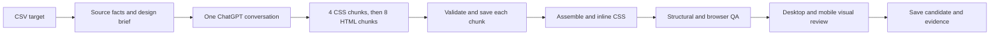

# ChatGPT website redesign workflow

The `chatgpt` branch now has a CSV-driven website workflow that follows this sequence:

## CSV and source context

`source_urls.csv` uses `website`, `business`, and `category`; `location` is optional. The target-matrix builder validates rows and selects either the first row or a requested row for a smoke run. `fetch_source_facts.py` fetches the homepage and up to seven same-domain pages linked for services, about, products, work, contact, location, or related topics. It records page text, headings, links, image assets, and contact-form controls. It only permits public HTTP(S) hosts. The complete audit stays in `debug/source_facts.json`; `prepare_candidate_context.py` sends a bounded excerpt of each page, selected links and image URLs, and the reusable design brief to ChatGPT so the first turn remains manageable. CSV metadata remains unverified context; page content is treated as reference data, not instructions.

The source facts and design brief are sent with the first CSS turn. The ChatGPT conversation then remains open on the same page for all part and acknowledgment turns. The optional website mode in `chatgpt_file_playwright_anonymous_ci.py` calls the existing `run_stage_once` response capture on that page. The persistent Chromium launch settings, newest-assistant-message extraction, and `.github/workflows/process-requests.yml` are unchanged. The new website workflow also uses the same headed Chromium under `xvfb-run`.

## Chunk sequence and recovery

The assistant must return CSS parts 1–4 in `css` fences, followed by HTML parts 1–8 in `text` fences. HTML preview blocks are rejected. Every response must have the expected visible label and run token outside exactly one fenced block, plus the matching first-line in-code part marker. A part is added to the manifest only after all checks pass. A rejected response stops the sequence before the next-part prompt is sent.

`chunks/capture_manifest.json` records conversation key, run token, ordered part names, paths, and SHA-256 hashes. Duplicate part content, wrong order, altered files, missing markers, and cross-run responses fail validation. `conversation_transcript.jsonl` stores each user prompt, newest assistant response, timing metadata, and acknowledgment. `chunks/sequence_checkpoint.json` is atomically updated before and after each turn, with the current conversation URL and pending part. If interrupted, dispatch the workflow with `resume_candidate` set to the saved folder under `chatgpt-runs/`. It reopens the saved conversation URL (or the supplied `resume_chat_url`) and continues with the first unaccepted part. Verified chunks remain in the manifest.

## Assembly and quality gates

After the final acknowledgment, the workflow validates and assembles exactly CSS 1–4 followed by HTML 1–8, writes `files/index.html` and `files/styles.css`, and embeds the CSS into `files/inlined/index.html`. The manifest hashes and first-line markers are checked again before assembly.

`browser_qa.py` renders that inlined page at desktop (1440×900) and mobile (390×844). It saves screenshots and checks requested sections, hero and CTA layout, mobile navigation by click and keyboard, horizontal overflow, and font/image loading. `site_quality.py` checks document structure, image URLs and alt text, CTA labeling, mobile navigation structure, substantive footer links, requested forms, and source contact-form field parity. The checker emits an `automated_success` result separately from human review.

The desktop/mobile screenshots are saved at `debug/screenshots/desktop.png` and `debug/screenshots/mobile.png` for visual review. Review templates are placed in `debug/review_templates/`. After inspection, copy and complete them as `debug/image_review.json` and `debug/visual_review.json`. The `chatgpt-website-review.yml` workflow then reruns the checker and updates `run_notes.json`; `final_success` remains false until both reviews pass. Candidate folders, logs, transcripts, checkpoints, reports, screenshots, and preview files are committed even when generation or automated QA fails, so failures are reviewable and resumable.

## Run the workflow

The workflow is `.github/workflows/chatgpt-website.yml`. A push that changes `chatgpt_automation/source_urls.csv` starts a one-target smoke run. Manual dispatch supports a one-row smoke test, a CSV batch, or resuming a saved candidate. The workflow uses one candidate attempt per CSV row in this initial version and serializes sites to keep ChatGPT requests sequential. The `process-requests.yml` API workflow remains separate and unchanged.

Generated candidate folders are stored under `chatgpt-runs/`. Each includes `debug/source_facts.json`, the exact design context and inputs, the chunk manifest, transcript, checkpoint, generated files, browser QA report, checker report, screenshots, and `run_notes.json`.
